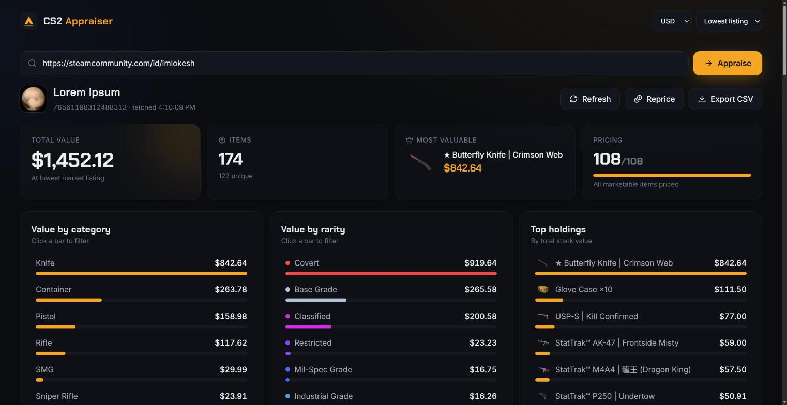
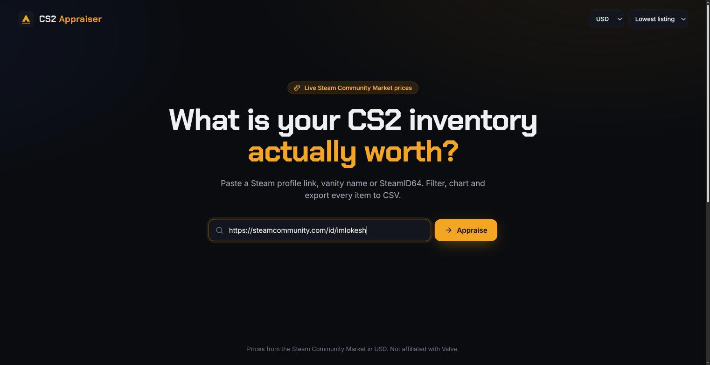
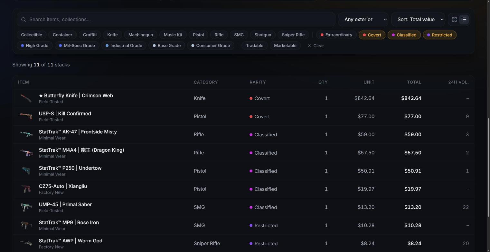
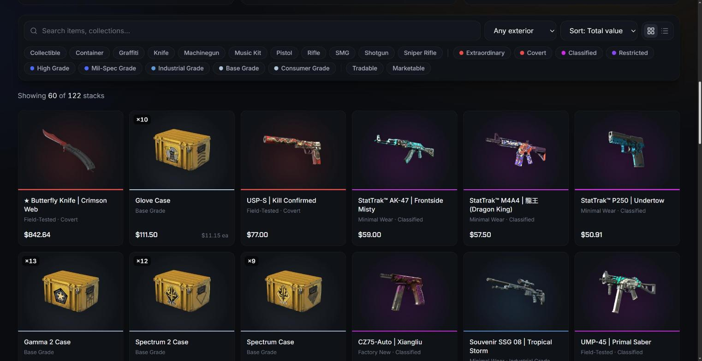

<div align="center">


# CS2 Appraiser

**What is your CS2 inventory actually worth?**

A fast, native desktop app that prices any public Counter‑Strike 2 inventory with live Steam Community Market data, then lets you slice it with filters and charts and export it to CSV.

[](https://github.com/imlokesh/cs2-inventory-desktop/releases/latest)
[](https://github.com/imlokesh/cs2-inventory-desktop/releases)
[](https://github.com/imlokesh/cs2-inventory-desktop/actions/workflows/release.yml)

[](LICENSE)

[**Download**](https://github.com/imlokesh/cs2-inventory-desktop/releases/latest) · [Features](#features) · [Install](#install) · [Build from source](#build-from-source)

<br />



</div>

## Features

- **Live Steam Market prices** in 38 currencies, valued at either the *lowest listing* or the *median sale* price
- **Total value at a glance**: item count, most valuable item, and pricing progress as it happens
- **Interactive charts**: value by category, value by rarity and your top holdings. Hover for details and click a bar to filter
- **Powerful filters**: search, category, rarity, exterior, tradable and marketable, plus five sort orders
- **Grid or table view** with item art, rarity colours, stack quantities and 24h volume
- **CSV export** of exactly what you're looking at (UTF‑8, opens cleanly in Excel and Sheets)
- **Paste anything**: profile URL, custom URL name, SteamID64, SteamID3 `[U:1:…]`, SteamID2 `STEAM_0:…`, or a trade offer link
- **Respectful of Steam**: prices the rarest items first, backs off automatically when rate limited, and caches prices on disk for 12 hours
- **Private by design**: no account, no server and no telemetry. The app talks only to `steamcommunity.com` from your own machine

<table>
  <tr>
    <td width="50%"></td>
    <td width="50%"></td>
  </tr>
  <tr>
    <td align="center"><sub>Paste a profile and go</sub></td>
    <td align="center"><sub>Filter by rarity and switch to the table view</sub></td>
  </tr>
  <tr>
    <td colspan="2"></td>
  </tr>
  <tr>
    <td colspan="2" align="center"><sub>Grid view with item art, rarity colours and stack totals</sub></td>
  </tr>
</table>

## Install

Grab the latest build for your platform from **[Releases](https://github.com/imlokesh/cs2-inventory-desktop/releases/latest)**:

| Platform | File | Notes |
|---|---|---|
| **Windows 10/11** | `CS2.Appraiser_x.y.z_x64-setup.exe` | Per-user install, no admin needed. An `.msi` is also available. |
| **macOS 11+** (Intel & Apple Silicon) | `CS2.Appraiser_x.y.z_universal.dmg` | Drag to Applications. |
| **Linux** | `.AppImage`, `.deb` or `.rpm` | AppImage: `chmod +x` and run. |

> [!NOTE]
> Builds are not code-signed yet.
> - **Windows:** SmartScreen may say "Windows protected your PC". Click **More info → Run anyway**.
> - **macOS:** if Gatekeeper says the app is damaged, run `xattr -cr "/Applications/CS2 Appraiser.app"` once.

## Usage

1. Paste a Steam profile (any of the formats above) and press **Appraise**. The inventory must be public.
2. Prices stream in, rarest items first. If Steam rate-limits you, the app pauses and resumes on its own; the countdown shows on the **Pricing** card.
3. Pick a currency and price basis in the top-right. Your choices and recent profiles are remembered.
4. Click chart bars or chips to filter, then use **Export CSV** to save the current view.
5. **Reprice** discards cached prices and fetches fresh ones from Steam.

## Where your data lives

The app follows each platform's conventions: settings go in the config directory, and re-downloadable price data goes in the cache directory, which the OS may clear without breaking anything.

| | Settings (`settings.json`) | Price cache (`prices.json`) |
|---|---|---|
| **Windows** | `%APPDATA%\com.imlokesh.cs2appraiser\` | `%LOCALAPPDATA%\com.imlokesh.cs2appraiser\` |
| **macOS** | `~/Library/Application Support/com.imlokesh.cs2appraiser/` | `~/Library/Caches/com.imlokesh.cs2appraiser/` |
| **Linux** | `~/.config/com.imlokesh.cs2appraiser/` | `~/.cache/com.imlokesh.cs2appraiser/` |

Both files are plain JSON and safe to delete. The Windows uninstaller offers to remove them for you.

## Build from source

**Prerequisites:** [Rust](https://rustup.rs) (stable), [Node.js](https://nodejs.org) 20+, [pnpm](https://pnpm.io), and the [Tauri system dependencies](https://v2.tauri.app/start/prerequisites/) for your OS.

```sh
git clone https://github.com/imlokesh/cs2-inventory-desktop.git
cd cs2-inventory-desktop
pnpm install

pnpm tauri dev      # run with hot reload
pnpm tauri build    # installers land in src-tauri/target/release/bundle/
```

Run the backend tests. `--include-ignored` adds a live test against the real Steam API:

```sh
cd src-tauri && cargo test -- --include-ignored
```

### Project layout

```
src/                     React + Tailwind UI
  App.tsx                layout, filters, charts, stats
  hooks/useInventory.ts  inventory loading, price queue, stacking
  lib/                   API bridge, currency parsing, CSV, settings
src-tauri/src/
  steam.rs               Steam client: profile resolution, paginated inventory, price overview
  price_cache.rs         on-disk price cache (12h TTL)
  settings.rs            validated user settings in the OS config dir
  lib.rs                 Tauri commands
```

### Releasing

Bump `version` in `package.json` and `src-tauri/Cargo.toml`, then push a tag:

```sh
git tag v0.2.0 && git push origin v0.2.0
```

GitHub Actions builds Windows, macOS (universal) and Linux installers and attaches them to a draft release, ready to review and publish.

## FAQ

**Why is pricing slow the first time?**
Steam allows about 20 price lookups per minute per IP. Every unique item needs one lookup, so a large inventory takes a few minutes. After that, prices come from the local cache for 12 hours.

**Why don't the prices match third-party sites?**
These are Steam Community Market prices, including Steam's fees, in the currency you pick. Third-party marketplaces usually trade below Steam.

**Is my Steam account at risk?**
No. The app never asks you to log in. It reads the same public pages your browser does.

## Acknowledgements

Built with [Tauri](https://tauri.app), [React](https://react.dev), [Tailwind CSS](https://tailwindcss.com) and [Lucide](https://lucide.dev) icons. Successor to [csgo-inventory-csv](https://github.com/imlokesh/csgo-inventory-csv).

Not affiliated with Valve Corporation. Counter‑Strike and Steam are trademarks of Valve Corporation.

## License

[MIT](LICENSE) © Lokesh Sharma
